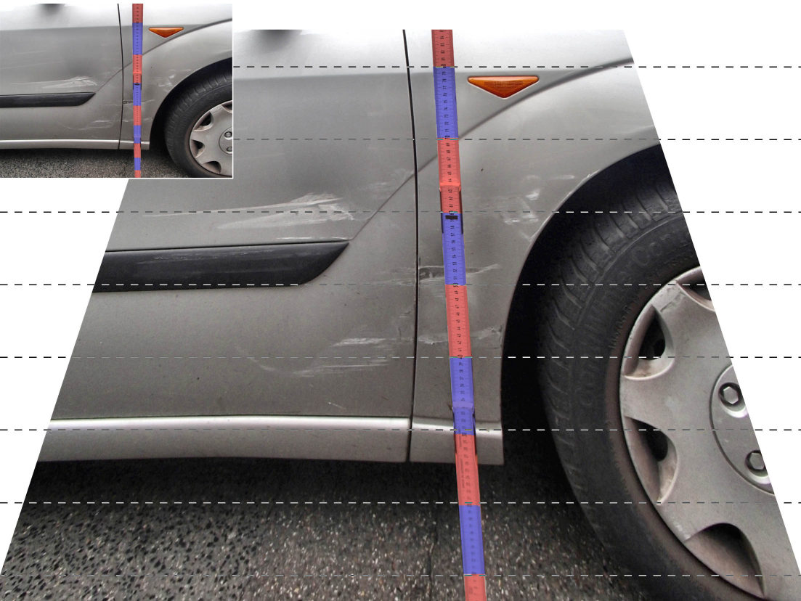

# Task
Police photographs of damaged vehicles, in particular, are often not to scale, as the camera’s main axis is not perpendicular to the plane of interest. Instead, the photographs are frequently taken at eye level, which leads to perspective distortion in the vertical direction. The open-source programme *Ruler* can (among other things) correct this vertical distortion.

# How it works
The command-line programme *Ruler* brings a photograph of a (damaged) vehicle into scale by adjusting its resolution (pixels per cm) to an integer value. As a prerequisite, a specific measurement must be known within the plane captured in the photograph, for example the vehicle’s wheelbase or a distance on a ruler (folding rule) placed against the vehicle.

Ideally, *Ruler* should be launched from an image viewer that specifies the selection area. Currently, this image viewer must be *IrfanView*, with the selection area specified in its title bar.

If the selection area is in portrait orientation (i.e. taller than it is wide, such as a folding rule), it is assumed that the reference dimension extends vertically; otherwise (when selected in landscape orientation), it extends horizontally (for example, the wheelbase).

If the reference object extends vertically (such as a folding rule leaning against the car), any potential perspective distortion in the vertical direction is corrected by *Ruler*.

*Ruler* prompts the user to enter the following values.

* Optional, and only if the selection area is in portrait orientation: position of the central measurement point on the folding rule in pixels. If no value is specified, the distortion correction is skipped.

* Actual distance of the longer side of the selection area in centimetres.

* Actual distance between the horizontal guide lines drawn on the (corrected) photograph, in centimetres.

If the selection area is in landscape orientation, its bottom edge represents the reference plane (in most cases, the floor level), and the guide lines are drawn relative to this plane.

If no selection area is specified, *Ruler* first asks for the extent of the reference distance (vertical or horizontal) and then for the upper and lower (or left and right) values in pixels.

# Download
The programme’s source code is available at https://github.com/whugemann/Ruler; the fully compiled programme specifically at https://github.com/whugemann/Ruler/releases:

* Extract the ZIP file into any folder.
* In *IrfanView*, set up *Ruler* as an external viewer, as described below.

# Setting up the launch from *IrfanView*
*Ruler* should be launched from within *IrfanView*. To do this, the programme must be defined as one of the three external editors/viewers. To do this, under *Options > Settings > Other*, enter the following line in one of the three input fields under *Set external editor/viewer*:

  >ExternalViewer9=path_to_Ruler.exe ""%1" /iv"

The parameter **/iv** signals to *Ruler* that it has been launched by *IrfanView* and passes the image filename as well as a selection area (in the title text). In *IrfanView*, up to ten different external image viewers can be launched by pressing Ctrl + [0 .. 9]. However, for the numbers 4 to 9, this is only possible by manually editing *IrfanView’s* INI file, the path to which can be found on the first page of the *Settings* dialogue box, usually

  >c:\Users\MyName\AppData\Roaming\IrfanView\i_view.ini

As *Ruler* has to search for the *IrfanView* window, problems may arise if more than one *IrfanView* window is open. You can prevent this by enabling the built-in setting for a single instance or by using the command-line argument /one.
